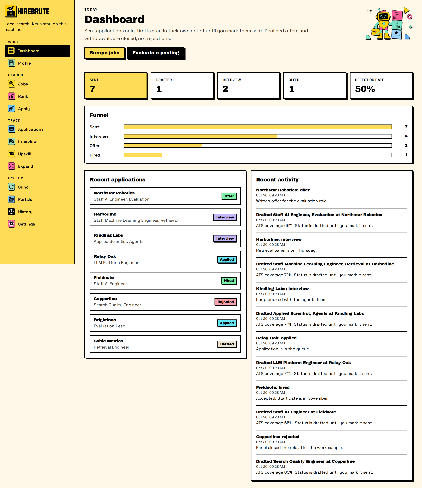

# Hirebrute

Hirebrute is a local job search app. It keeps your profile, drafts, and API keys in a JSON file on your machine. The browser talks to a small Node server. That server is the only process that calls a model.

▶️ [Watch the demo](docs/demo.mp4)



The workflow follows [ai-job-search](https://github.com/MadsLorentzen/ai-job-search) by Mads Lorentzen. Hirebrute adds a UI, provider switching, a history log, and export. The original project is MIT licensed.

## Features

- Build a profile from pasted text, a CV, or notes. The first launch is empty.
- Search public boards: Remotive, Arbeitnow, Remote OK, The Muse, and freehire. LinkedIn is not scraped. An offline test board exists and stays off.
- Rank new postings. A language or eligibility failure sets the score to 0 and names the gate.
- Evaluate one posting, then draft a CV and a cover letter. The apply flow runs a reviewer pass and an ATS text check, then saves the files.
- Record outcomes, prep an interview, write a follow-up, and build an upskill list from recorded gaps.
- Export JSON, CSV, HTML, or a zip. Gmail updates are a paste you approve. Notion is a one-way snapshot.

Drafts are excluded from the sent count. `offer_declined` and `withdrawn` are closed applications. They are not counted as rejections.

## Quick start

You need Node 22 or newer.

```bash
npm install
npm run dev
```

Open http://127.0.0.1:4317. The API listens on http://127.0.0.1:4318. Vite proxies `/api` to that port.

To run the production build on one port:

```bash
npm run build
npm start
```

`npm start` serves the built UI and the API at http://127.0.0.1:4318.

Fill in Profile before you send a real application. Settings, then Reset, asks you to type `RESET` before it deletes local data.

```bash
npm test
npm run test:e2e
npm run lint
npm run typecheck
npm run check:secrets
```

`npm run test:e2e` drives the app in Chromium. Install the browser once with `npx playwright install chromium`.

## Providers

Choose the active provider on the Settings page. The server checks which CLIs and keys are present. Settings saves keys in `data/store.json`. Git does not track that file.

| Provider | Authentication |
| --- | --- |
| Mock | Always available. No network and no key. |
| Claude Code CLI | A `claude` binary on `PATH`. Uses your Claude subscription. No key is stored. |
| Codex CLI | A `codex` binary on `PATH`. Uses your ChatGPT subscription. |
| Grok CLI | A `grok` binary on `PATH`, if you have one. |
| Anthropic API | Key from https://console.anthropic.com/ |
| OpenAI API | Key from https://platform.openai.com/ |
| xAI API | Key from https://console.x.ai/ |
| Gemini API | Key from https://aistudio.google.com/ |
| OpenRouter | Key from https://openrouter.ai/ |

```bash
which claude
which codex
which grok
```

Settings marks a missing binary as not installed. Offline test mode stays off until you select it.

Environment variables are optional. See `.env.example`. Do not put API keys there. Enter keys in Settings.

## Where files live

| Path | Contents |
| --- | --- |
| `data/store.json` | Profile, jobs, applications, settings, keys |
| `data/applications/` | Draft CV, cover letter, and PDF files |
| `data/documents/` | Text you paste during setup |
| `data/exports/` | JSON, CSV, HTML, and zip downloads |

Git ignores `data/` except `data/.gitkeep`.

## Job boards

Built-in boards are Demo, Remotive, Arbeitnow, Remote OK, The Muse, and freehire.me. Turn a board off on the Portals page. You can add a public RSS or JSON search URL.

Paste a posting when a board has no public API. LinkedIn's terms disallow scraping, so this app does not scrape it.

## Workflow map

| Original command | Hirebrute page |
| --- | --- |
| `/setup` | Profile |
| `/scrape` | Jobs |
| `/rank` | Rank |
| `/apply` | Apply |
| `/interview` | Interview |
| `/outcome` | Applications |
| `/upskill` | Upskill |
| `/expand` | Expand |
| `/html-report` | Dashboard, plus HTML export |
| `/add-template` | Portals page, templates section |
| `/add-portal` | Portals |
| `/gmail-sync` | Sync, paste then approve |
| `/notion-sync` | Sync, one-way snapshot |
| `/reset` | Settings |

Hirebrute writes Markdown and a text-layer PDF. You do not need TeX installed.

More screens are in `docs/screenshots/`.

## Architecture

```
src/          React UI. Vite serves it on port 4317.
server/       Express API on port 4318. Workflows, portals, providers.
shared/       Fit gates, dashboard math, and shared types.
tests/        Vitest. Core rules are tested without a browser.
data/         Local store. Created on first run. Gitignored.
```

`server/providers/registry.ts` exposes `detectProviders()` and `generate()`. `generate()` takes a system prompt, a user prompt, and an optional JSON flag. CLI providers, API providers, and the mock provider share that call. Fit rules live in `shared/fit.ts` and `shared/postingGuard.ts`. Rank and apply both use those gates.

## Roadmap

- Run a LaTeX or Typst template when that compiler is on `PATH`.
- Read Gmail with OAuth. The current Sync page only accepts pasted threads, and it still requires approval before a write.
- Send the Notion snapshot with the token from Settings. Edits in Notion still do not flow back.
- Load an optional local salary table. The original project ships a salary lookup script. This app does not bundle that dataset.

## Contributing

See [CONTRIBUTING.md](CONTRIBUTING.md).

## License

[MIT](LICENSE). Copyright 2026 Amr Tawfik.

This repository is an application. `package.json` sets `private` to true, so npm will not publish it.
